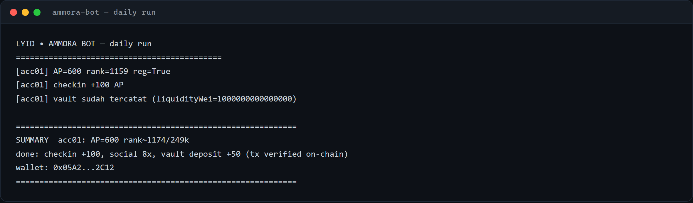

# Ammora Bot (Season 2)

**Versi:** 1.0.0 · **Harga:** Rp 65.000 (~$4) · **Kontak pembelian:** [@rmndkyl](https://t.me/rmndkyl)

Bot automation untuk **Ammora Season 2** (liquidity protocol di atas GIWA — L2 milik Dunamu/Upbit, chainId `91342`). Murni HTTP + transaksi on-chain ringan, **tanpa browser**.

## Kebutuhan

| Item | Detail |
|---|---|
| Runtime | Node.js 18+ |
| Wallet | EVM / sesuai chain proyek (kamu sendiri) |
| Proxy | tidak perlu |
| Captcha | tidak perlu |
| Akses | akun proyek yang kamu kelola sendiri |

## Pembayaran

E-Wallet: DANA / GoPay / ShopeePay · Bank: BCA / Seabank · Crypto: contact for wallet address.
Pembeli menghubungi [@rmndkyl](https://t.me/rmndkyl), kirim bukti transfer, lalu terima license key.

---

> Status reward: $tAMM testnet + SBT (pool 20M $tAMM). Konversi $tAMM → $AMM direncanakan setelah mainnet GIWA. Belum ada TGE/date resmi. Airdrop = spekulatif; nilai nyata saat ini: kursi beta top-1.000 leaderboard.

## Fitur

| Aksi | Reward | Cara |
|---|---|---|
| Daily check-in | +100 AP | API signed action `checkin` |
| Social backlog (eco/baekho/channel/chat/repost/like/comment/follow) | +50/+100 AP sekali | API `claim-social` (identity X sudah verified via web sekali jalan) |
| Vault transfer harian | +50 AP | tx `deposit()` 0.001 test ETH → API `verify-transaction` (retry utk lag indexer) |
| Stake $tAMM (one-time +100 AP) | ⚠️ belum stabil | signature `stake(uint256)` revert di build ini — dicatat UNVERIFIED, lakukan manual di situs |
| Laporan status per akun | — | `--status` read-only |

## Humanisasi (anti-sybil)

Ammora menulis di pesan registrasinya: **"One verified X identity may participate with one wallet"** dan mengaktifkan kontrak identity. Jadi scaling yang benar = 1 identitas X : 1 wallet (bukan multi-wallet satu X). Yang di-randomisasi modul `src/humanize.py`:

- `run_jitter` — start acak 0–900 dtk, cron tidak pernah jalan di detik yang sama
- `account_stagger` 40–180 dtk antar akun; `mission_gap` 25–110 dtk antar aksi (+ kemungkinan "kesamber" lama)
- urutan misi di-shuffle tiap run; gate misi (checkin/vault) tidak pernah diskip
- `should_skip` 12% — tapi hanya untuk backlog non-rotten (sehari-harian tidak dibuang)
- satu wallet berbeda per akun — sink address bersama adalah link paling jelas di graph

## Kebutuhan

| Item | Nilai |
|---|---|
| Python | 3.10+ |
| Paket | `eth-account`, `pycryptodome` (`pip install -r requirements.txt`) |
| Wallet | EVM, sudah didaftarkan di ammora.org/waitlist + X verified (manual sekali per identitas) |
| Test ETH | Faucet: https://faucet.lambda256.io/giwa-sepolia (0.01/24j) atau https://faucet.giwa.io (0.005/24j, Turnstile) |
| Modal | **Rp 0** — semua testnet |

## Setup

1. Copy `config.json.example` → `config.json`, isi private key + label per akun.
2. Pastikan wallet sudah **registered & X-verified di website** (bot tidak bikin akun).
3. Klaim faucet untuk wallet (butuh ≥0.002 ETH test utk vault + gas).

```bash
python -m src.main --status                      # cek AP/rank semua akun (cepat, tanpa sleep)
python -m src.main --daily                       # pass harian penuh
python -m src.main --daily --accounts acc01 --no-jitter --max-tx 1   # run uji terkendali
```

## Contoh output run nyata (16 Nov 2026, 1 wallet)

```
[acc01] AP=550 rank=1195 reg=True
[acc01] checkin +100 AP
[acc01] sending 0.001 ETH to vault via deposit()...
[acc01] verify vault -> ok
SUMMARY: acc01: AP=600 done=['vault +50'] skipped=['vault (today done)'] errors=[]
```

## Catatan teknis

- Auth = `personal_sign` atas pesan `Ammora Season 2 action ...` — tidak ada cookie/sesi.
- Header `Origin` + `Referer` wajib; API menolak tanpa itu (`invalid_origin`).
- Reset harian mengikuti `period` di event ledger server (tanggal UTC), bukan jam lokal.
- Vault butuh nilai **tepat** 0.001 ETH — bukan lebih, bukan kurang (event dicek exact).

## Troubleshooting

| Gejala | Solusi |
|---|---|
| `SEASON2_ONBOARDING_REQUIRED` | Wallet belum register/X verify di web — selesaikan onboarding manual |
| `service_unavailable` saat verify vault | Indexer telat — bot sudah retry 5x; jalankan ulang, hash sama akan reconcile |
| `vault (no gas)` | Klaim faucet lagi (butuh 0.001 vault + cadangan gas) |
| `INVALID_MISSION` | Nama misi diganti server — cek daftar di state / bundle |

## Tangkapan layar



## Keamanan
`config.json` (private key) di-gitignore. Jangan pernah share. Kode: org `layerairdrop` (private), showcase: github.com/rmndkyl/ammora-bot.

*Dibuat oleh LYID — Layer Airdrop ID. Update project lifecycle dipantau cron claim-tracker (TGE/mainnet signal).*
